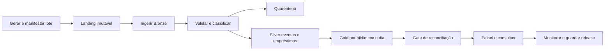

# 01 — Pipeline de dados Aurora: da origem ao consumo

**Estado demonstrado:** MVP validado. Evidências de 28/10/2026 quando aplicável.

Este documento preserva requisitos e design do estudo. Etapas futuras, quantidades planejadas e critérios de aceite não comprovam execução. Consulte o estudo de caso para escopo, resultados e limites atuais.

**Estado do plano original:** planejado; nenhuma tabela, pipeline ou Job implementado nesta entrega. **Papel no portfólio:** principal demonstração de engenharia de dados de ponta a ponta. **Dependência:** somente validação dos recursos da conta. Aplicam-se os padrões de `00_PLANEJAMENTO_GERAL.md`.

## Objetivo, escopo e requisitos

Entregar um produto de dados sobre circulação de livros, explicando como cada número sai dos eventos da origem e chega a um painel confiável.

| ID | Requisito | Critério de aceite futuro |
| --- | --- | --- |
| RF01 | Ingerir lotes JSON/CSV sintéticos versionados | Manifesto de cada lote com hash, contagem e origem |
| RF02 | Preservar Bronze e a linhagem da carga | Todo registro aponta para lote, arquivo e execução |
| RF03 | Validar/deduplicar Silver e separar rejeitados | Cada entrada classificada exatamente uma vez no relatório da carga |
| RF04 | Materializar métricas Gold | Totais reconciliados com eventos e casos manuais |
| RF05 | Orquestrar de forma repetível | Um Job manual executa o DAG sem passos ocultos |
| RF06 | Consumir em SQL e painel | Três perguntas de negócio respondidas com filtros definidos |
| RF07 | Reprocessar e recuperar falhas | Repetição de lote sem duplicação e saída válida preservada |
| RNF01 | Operar com volume de estudo | 5.000 eventos inicialmente, sem dependência de GPU ou fonte paga |
| RNF02 | Reproduzir uma release sem Git | Snapshot, manifesto, parâmetros e versões dos dados preservados |

Fora da primeira versão: Kafka, CDC de banco externo, streaming contínuo e dimensionamento corporativo. Evolução opcional: microbatch com Auto Loader e pipeline declarativo após o batch ser validado.

## Dados e contratos

Gerar 3 bibliotecas, 200 livros e eventos de 30 dias. Entidades: `library`, `book`, `loan_event`. Sem dados de pessoas reais. Semente inicial proposta: 42.

| Campo | Tipo lógico | Regra |
| --- | --- | --- |
| event_id | string | Chave do evento, obrigatória |
| event_type | string | loan, return ou renewal |
| event_time | timestamp UTC | Momento do evento; formato e timezone explícitos |
| library_id / book_id | string | Referências válidas às dimensões |
| loan_id | string | Liga os eventos de um mesmo empréstimo |
| schema_version | integer | Versão do contrato da origem |
| batch_id | string | Chave do lote de aquisição |

Adicionar na ingestão `source_file`, `source_hash`, `ingested_at` e `execution_id`. Chaves repetidas com payload igual são duplicatas; payloads conflitantes para a mesma chave vão à quarentena para revisão, sem desempate silencioso. Aceitar nova coluna opcional após mudança explícita do contrato; tipo incompatível bloqueia a carga.

Destinos propostos: `workspace.estudos_bronze.aurora_eventos`, `estudos_silver.aurora_eventos_validos`, `estudos_silver.aurora_eventos_quarentena`, `estudos_silver.aurora_emprestimos`, `estudos_gold.aurora_circulacao_diaria` e `estudos_ops.aurora_cargas`. Arquivos originais em Volume `workspace.estudos_bronze.fontes`, se habilitado, sob `aurora/<dataset_version>/<batch_id>`.

## Arquitetura e DAG

O Job `aurora_dados_e2e` terá tarefas de origem, Bronze, Silver, Gold, validação e publicação. As tarefas recebem `dataset_version`, `batch_id`, `data_reference` e `execution_id`. Publicação só ocorre após o gate; o painel lê a release aprovada, por view ou filtro de release. A primeira versão não presume transação atômica entre várias tabelas: um manifesto de release controla qual conjunto completo está liberado.

Eventos atrasados: aceitar até 7 dias na proposta inicial, recalcular os dias/empréstimos afetados e registrar revisão da Gold; fora dessa janela, exigir backfill explícito. A janela é decisão de negócio a testar, não limite da ferramenta. Usar estratégia batch idempotente com MERGE/recomputação de partição validada antes de introduzir watermark ou checkpoint.

## Stack e decisões técnicas

| Componente/lib | Uso e decisão |
| --- | --- |
| Python stdlib, `hashlib`, `json`, `datetime` | Gerador, manifesto e controle de lote |
| PySpark SQL/functions | Parsing, tipos, joins, deduplicação e agregação |
| Delta / `delta.tables` compatível com runtime | Escrita idempotente e rastreabilidade das versões |
| Lakeflow Jobs | DAG, parâmetros, tentativas e reparo de tarefas |
| `pyspark.pipelines` | Evolução opcional para Lakeflow declarativo; não obrigatório no MVP |
| MLflow | Comparar estratégias de ingestão/reprocessamento; não criar Model Registry para ETL |
| SQL + AI/BI Dashboard | Consumo das métricas e demonstração |

Não instalar Spark/Delta de versões independentes sobre o runtime. Auto Loader só entra na segunda versão se o ambiente suportar a fonte e o modo de execução escolhido. Documentar custo de descoberta de arquivos, schema location e checkpoint separado por fluxo nessa evolução.

## Regras de métricas e qualidade

- Empréstimos diários: contar `loan_id` distintos com evento `loan` válido naquele dia/biblioteca.
- Em aberto na data de referência: empréstimos iniciados até a data, sem devolução válida até essa mesma data. Renovações não criam novos empréstimos.
- Duração: intervalo entre início e primeira devolução válida, apenas em empréstimos concluídos. Mostrar também o número de concluídos; não misturar com duração de empréstimos abertos.
- Reconciliação por lote: entradas = aceitos novos + duplicatas idênticas + rejeitados; conflitos de chave contam como rejeitados. Em reprocessamento, comparar payload e hash para não somar de novo.
- A integridade do empréstimo envolve mais de uma linha: devolução sem início fica pendente/quarentena até backfill; duração negativa não entra na Gold.

## MLflow e experimentos planejados

Experimento proposto: `.../01_lakehouse_aurora/experimentos/engenharia_pipeline`.

| Experimento | Comparação controlada | Métricas |
| --- | --- | --- |
| D01 | Carga integral × lote incremental no mesmo dataset | duração, linhas lidas/escritas e reconciliação |
| D02 | Primeira carga × repetição do mesmo lote | novas linhas e variação da Gold, ambas esperadas em zero na repetição |
| D03 | Evento pontual × evento atrasado | dias afetados e correção do estado do empréstimo |
| D04 | Batch validado × declarativo opcional | mesmo resultado lógico; duração e esforço operacional |

Guardar parâmetros de lote, estratégia, tamanho e versão; artefatos: contrato, manifesto, DAG, relatório de checks e plano das consultas relevantes. A duração só será meta depois de medir o ambiente. Limite inicial: até 10 execuções pequenas por rodada de estudo.

## Validação e falhas

Casos: carga limpa; 5 duplicatas iguais; 2 chaves conflitantes; biblioteca inexistente; novo campo opcional; tipo inválido; evento 3 dias atrasado; falha após Bronze; backfill; lote repetido. Preparar um gabarito mínimo de 10 empréstimos calculado manualmente.

Falha transitória de tarefa: até 2 novas tentativas com intervalo; falha de contrato não deve repetir automaticamente. Reparo deve reutilizar o lote preservado, registrar a tentativa e não publicar uma Gold incompleta. A demonstração deve mostrar a falha e a retomada, não somente a execução feliz.

## Roteiro e entregáveis

1. **Contrato:** dicionário, gerador planejado e gabarito de 10 empréstimos.
2. **Ingestão:** notebook `01_origem_landing`, `02_bronze` e manifesto.
3. **Transformação:** `03_silver`, `04_gold` e relatório de reconciliação.
4. **Operação:** Job parametrizado, `05_validacao`, publicação controlada e recuperação.
5. **Consumo:** painel com empréstimos, abertos e duração; linhagem de uma métrica até o arquivo.
6. **Evolução:** experimento incremental/declarativo e release preservada.

**Design da demonstração, 5–7 minutos:** apresentar a fonte → disparar um lote pequeno → inspecionar Bronze/Silver/Gold → abrir o painel → repetir o lote → inserir um erro → mostrar bloqueio e reparo. Evidência final: execução do Job, consultas de validação, painel e manifesto da release.

Riscos: quotas, schema drift, semântica de eventos atrasados e publicação parcial. Mitigações estão nos contratos, na amostra pequena e no manifesto de release. Requisitos abertos antes da implementação: recursos habilitados, permissões de Volume/schema, versão do runtime e recursos de publicação de painel.

Referências: [Lakeflow Jobs](https://docs.databricks.com/aws/en/jobs/), [API Python de pipelines](https://docs.databricks.com/aws/en/ldp/developer/python-ref) e [MLflow Tracking](https://mlflow.org/docs/latest/ml/tracking/).
