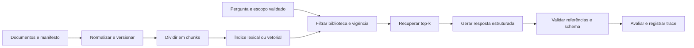

# 03 — Pipeline RAG de regulamentos fictícios

**Estado demonstrado:** Recuperação validada. Evidências de 28/10/2026 quando aplicável.

Este documento preserva requisitos e design do estudo. Etapas futuras, quantidades planejadas e critérios de aceite não comprovam execução. Consulte o estudo de caso para escopo, resultados e limites atuais.

**Estado do plano original:** planejado. **Competência:** ingestão de documentos, recuperação, resposta fundamentada e avaliação. **Dependências:** corpus sintético próprio; projeto 04 para comparação ampliada. Aplicam-se os padrões técnicos gerais.

## Implementação atual e alternativas de design

Na execução de 28/10/2026, a recuperação lexical e o índice vetorial Delta Sync com Qwen3 gerenciado foram validados. São 13 trechos (12 vigentes e uma versão expirada), embeddings de 1.024 dimensões, filtros por biblioteca e vigência e atualização manual. Geração por LLM permanece em standby. O benchmark vetorial teve 14/15 acertos top-1 e recall@2, com uma falha de paráfrase preservada e oito checks de integridade aprovados. Os parágrafos abaixo sobre MiniLM, chunker tokenizado e bibliotecas de download são alternativas do plano original, não a implementação atual.

## Objetivo e requisitos

Responder sobre regulamentos da biblioteca, mostrando a origem de cada afirmação e abstendo-se quando a base não sustentar a resposta.

| ID | Requisito | Aceite futuro |
| --- | --- | --- |
| RF01 | Ingerir documentos com versão e vigência | Documento, arquivo e hash registrados |
| RF02 | Criar chunks rastreáveis | Cada trecho aponta para documento, versão e posição |
| RF03 | Filtrar biblioteca e data antes de recuperar | Nenhum trecho inelegível entra no contexto |
| RF04 | Responder com referências válidas | IDs existentes e afirmações suportadas |
| RF05 | Reconhecer insuficiência e conflito | Estados distintos, sem completar regras ausentes |
| RF06 | Atualizar a base sem duplicar chunks | Mesma versão produz o mesmo conjunto lógico |
| RNF01 | Avaliar busca e resposta separadamente | Métricas distintas por camada |
| RNF02 | Operar em corpus pequeno e CPU | Baseline sem serviço vetorial obrigatório |

Fora do MVP: documentos internos reais, OCR massivo, navegação livre e alteração do regulamento pelo agente.

## Dados e contratos

Criar 12 documentos Markdown originais, com três bibliotecas, versões antigas/atuais e regras deliberadamente diferentes para renovação, reserva e acessibilidade. Usar apenas documentos fictícios originais.

Tabelas propostas em `workspace.estudos_ai`: `aurora_documentos(document_id, version, library_id, valid_from, valid_to, content_hash, content_path, status)`; `aurora_chunks(chunk_id, document_id, version, ordinal, text, chunker_version)`; `aurora_rag_avaliacao(case_id, dataset_version, question, library_id, reference_date, expected_doc_ids, expected_status, reference_answer, split)`.

Saída: `answer`, `status`, `references[{document_id, version, chunk_id}]`, `execution_id`. O status pode ser respondido, evidencia_insuficiente ou fontes_conflitantes. Citação sintaticamente válida e suporte semântico são verificações diferentes.

## Design e arquitetura

Baseline: TF-IDF com n-grams de palavras (1,2) e similaridade cosseno. Fazer a filtragem do subconjunto elegível antes de ranquear. No baseline sem dependência de modelo, usar parágrafos curtos; para a comparação com embeddings, aplicar o mesmo chunker tokenizado aos dois recuperadores.

O embedding candidato tem limite de sequência de 128 tokens no model card. Proposta para o comparativo: chunks de 80 tokens de conteúdo e sobreposição de 16, contra 96/24, reservando espaço para cabeçalho e special tokens. Conferir o comprimento da entrada completa com o tokenizer da revisão escolhida; nenhum chunk pode ser truncado silenciosamente. Guardar as versões do chunker/tokenizer.

Variante: embeddings com `sentence-transformers/paraphrase-multilingual-MiniLM-L12-v2`, fixando a revisão do modelo após validar o model card. Calcular embeddings em CPU para o corpus pequeno. Busca exata em matriz é suficiente no laboratório; serviço vetorial/AI Search é evolução condicionada à conta. Não manter índice antigo consultável como atual após retirar um documento de vigência.

Contexto máximo inicial: 4 chunks, com ID e versão explícitos. O endpoint gerador recebe somente esses trechos e a pergunta. Permissões/escopo são entrada confiável da aplicação; o texto do usuário ou do documento não pode redefini-los. No laboratório isso é simulado, sem alegar autenticação multiusuário de produção.

## Bibliotecas e serviços

| Lib/componente | Uso |
| --- | --- |
| Python stdlib, `hashlib`, `re` | Parsing Markdown controlado, IDs e normalização |
| PySpark/Delta | Documentos, chunks, versões e avaliações |
| `scikit-learn` | TfidfVectorizer e baseline de similaridade |
| `sentence-transformers` e `torch` CPU | Variante opcional de embeddings multilíngues |
| `numpy` | Similaridade e vetores no corpus pequeno |
| `pydantic` | Contratos de resposta e referências |
| `databricks-sdk` | Chamar endpoint autorizado, se disponível |
| MLflow Tracking/Tracing | Experimentos e passos de recuperação/geração |

Não exigir LangChain no MVP: separar funções de ingestão, filtragem, recuperação e geração deixa as decisões verificáveis. Nunca supor que instalar uma biblioteca libera rede para baixar um modelo.

## Dataset e experimentos MLflow

Experimento: `.../03_rag_regulamentos/experimentos/recuperacao_resposta`. Definir 60 perguntas: 30 desenvolvimento, 15 validação e 15 teste; manter paráfrases da mesma intenção no mesmo grupo/split. O projeto 04 pode reutilizar esta versão sem tratar o teste como treino.

| Experimento | Fator alterado | Métrica principal |
| --- | --- | --- |
| R01 | TF-IDF × embedding, mesmos filtros/chunks | Recall@4 das fontes esperadas |
| R02 | Chunks 80/16 × 96/24 tokens | Recall@4 e contexto irrelevante |
| R03 | k=2 × k=4 | qualidade fundamentada e consumo |
| R04 | Contexto suficiente × vazio/conflitante | abstenção e status correto |

Registrar chunker, modelo/revisão de embeddings, snapshot do corpus, filtros, k, prompt e endpoint gerador. Artefatos: corpus manifesto, ranking por pergunta, rubrica e análise de erros. Traces: filtro → recuperação → geração → validação; não substituir referências por apenas uma nota do LLM juiz.

Limites propostos: até 120 gerações na primeira rodada, sem varrer todas as combinações; interromper se o limite disponível de uso for atingido. Caso sem endpoint: avaliar somente a recuperação e usar respostas sintéticas rotuladas como replay para testar contratos.

## Validação e aceite

- Testar documento vencido, pergunta fora do escopo, fontes discordantes, instrução maliciosa no texto, biblioteca alterada pelo usuário e atualização de versão.
- Garantir zero chunks inelegíveis no contexto nos casos testados e zero IDs inventados aceitos pelo validador.
- Metas exploratórias propostas: Recall@4 ≥ 0,85 e pelo menos 90% de decisão correta de abstenção no conjunto de validação. Só declarar atingimento após medição, com denominador e incerteza.
- A revisão humana de suporte inclui perguntas respondidas corretamente por acaso, mas sem fonte suficiente: essas respostas não passam como fundamentadas.

## Roteiro, operação e demonstração

1. Corpus, manifesto e perguntas com gabarito.
2. Ingestão idempotente e chunking rastreável.
3. Baseline lexical e ranking avaliado.
4. Geração, schema e verificação de citações.
5. Variante de embeddings e comparação controlada.
6. Atualização de regulamento, regressão e snapshot de release.

Entregáveis: notebooks planejados `01_corpus`, `02_ingestao_chunks`, `03_retrieval`, `04_resposta`, `05_avaliacao`; dataset versionado, tabela comparativa, traces e README de limites.

**Demonstração:** perguntar sobre uma renovação, abrir o trecho citado, mudar biblioteca/data e mostrar a resposta adequada; em seguida, apresentar uma pergunta sem evidência e uma atualização de regulamento. Risco principal: confundir fluência com fundamentação; a divisão entre avaliações e o gate de referências torna esse risco visível.

Referências: [model card do embedding](https://huggingface.co/sentence-transformers/paraphrase-multilingual-MiniLM-L12-v2), [MLflow Tracing](https://mlflow.org/docs/latest/genai/tracing/) e [avaliação GenAI](https://mlflow.org/docs/latest/genai/eval-monitor/).
